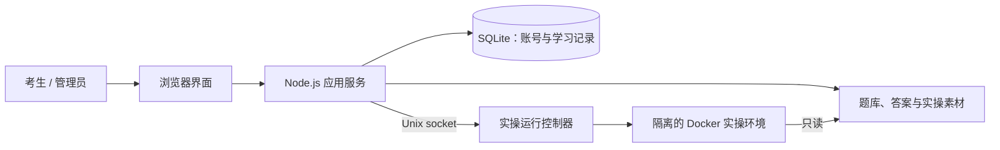

# 知练

**面向人工智能训练师三级考试的理论与实操刷题工具。**

知练把题库练习、在线实操和模拟考试放在同一个网站里。管理员统一分配账号，每位考生独立保存自己的练习进度、错题和考试记录。

> 本项目用于备考练习，并非官方考试平台；成绩和自评结果仅供参考。

## 项目功能

| 功能 | 可以做什么 |
| --- | --- |
| 考试倒计时 | 概览显示距离考试的天数，可切换11月14日和12月27日场次；按北京时间每日更新，过期后自动转到下一场。 |
| 每日50题 | 每天北京时间0点刷新，固定判断20题、单选20题、多选10题；各题型内优先错题，当天可续做。 |
| 理论练习 | 按题型练习 900 道题，搜索题目、即时查看结果，收藏题目并复习错题；自动记录位置并续做。 |
| 实操练习 | 练习 40 道实操题，对照题目填写代码或文字，按需查看参考答案；也可以在自己的电脑上完成操作。 |
| 在线工作区 | 在网页中使用 Notebook 运行 Python，并使用表格、文档和文件工具处理实操素材。 |
| 模拟考试 | 提供官方模拟卷和系统组卷，支持计时、自动保存、标记疑题、断线恢复、交卷和历史回顾。 |
| 学习记录 | 查看个人练习进度、收藏、错题和历史作答；不同账号的数据相互隔离。 |
| 账号管理 | 管理员创建、停用账号和重置密码，设置临时空间配额，并查看用户进度和作答记录。网站不开放自主注册。 |
| 运行任务管理 | 查看在线工作区的运行和排队情况；考生可以结束自己的任务，管理员可以管理全部任务。结束任务不会交卷或删除已保存的文字答案。 |

系统模拟卷的理论部分按题型抽取 **133 道题库原题和 57 道扩展题**，整体约为 70% 和 30%。扩展题经过校验，但与正式考试难度的可比性仍需实际检验。

## 考生使用指南

1. **登录**：使用管理员分配的账号和初始密码登录，首次登录按提示修改密码。
2. **练习理论**：可从概览进入每日50题，或进入完整题库按题型练习。每日题组当天固定并保存进度，跨天换新；普通练习位置独立保存在账号下；进入理论练习，选择题型或搜索题目，提交后查看结果；答错的题目会进入错题本，也可以收藏需要复习的题。
   手机答题时，提交与下一题操作固定在底部，切题后自动定位题目。
3. **练习实操**：选择题目，在题目旁填写答案。需要运行代码或操作素材时，可以启动网页环境，也可以选择在自己的电脑上操作。练习时可查看参考答案，对照正确写法。
4. **参加模拟考试**：选择官方模拟卷或系统组卷，按页面提示作答。考试期间可标记疑题，答案会自动保存；交卷后可查看成绩与历史作答。
5. **结束实操前下载文件**：在线工作区中的上传文件和生成文件属于临时文件，结束练习或交卷后会清理；需要保留的文件请提前下载。已保存的作答文字和成绩会保留。

在线运行资源有限时，任务会排队。可通过页面上的运行任务列表查看状态并结束自己的任务。

## 答案与评分

- **理论**：以项目整理的 Excel 答案为准。模拟卷未答题按零分计，但不加入已练题数或错题本。
- **实操**：以随项目提供的 PDF 参考答案为准，包括代码和小作文。
- **代码填空**：按标准写法严格比较，保留代码内部的空格、缩进、引号和变量名；能运行并不代表填空符合标准答案。
- **人工核对**：18 个代码评分项因 PDF 原文字符不够清晰，暂不自动判分，需对照 PDF 自评；报告、文档和小作文等成果也需要参考答案自行核对。

## 项目架构



- **前端**：原生 HTML、CSS 和 JavaScript；编辑器、表格等浏览器依赖位于 `zhilan/public/vendor/`。
- **应用服务**：Node.js 提供登录、题目、练习、考试和管理接口，使用 SQLite 保存账号、进度和作答。
- **题库**：`刷题工具数据/` 保存题目、原始答案及实操素材；`zhilan/question-bank/` 和 `zhilan/verified-answers/` 保存扩展题及评分数据。启动时会校验题库文件摘要。
- **实操环境**：独立控制器通过受权限限制的 Unix socket 接收请求，使用 Docker 创建隔离的 Python 环境。容器禁用网络、限制资源并以只读方式挂载素材；临时文件在工作区结束后清理。

## 本地运行

### 1. 准备环境

- Node.js **22.13 或更新版本**（使用 Node 内置 SQLite）。
- 需要网页在线实操时，另需安装并启动 Docker；只使用理论练习或文字作答可先不启动实操环境。
- 仓库包含较大的实操模型和 PDF，克隆需要较多时间和磁盘空间。

```bash
git clone https://github.com/3choL1nG/zhilan.git
cd zhilan/zhilan
```

### 2. 创建管理员并启动网站

```bash
node scripts/admin.mjs
node src/server.mjs
```

按提示设置管理员账号和初始密码，然后打开 **http://127.0.0.1:8787** 登录。管理员可在网站内为考生创建账号。

默认数据保存在 `zhilan/data/`；默认题库位于与 `zhilan/` 同级的 `刷题工具数据/`。不要把数据目录、账号或密码提交到公开仓库。

### 3. 启用网页在线实操

在 `zhilan/` 目录构建镜像：

```bash
docker build -t zhilan-python:1 ./runtime
```

保持 Docker 运行，另开终端，在同一个 `zhilan/` 目录启动控制器：

```bash
node src/controller.mjs
```

控制器默认通过 `data/runtime.sock` 与网站通信。随后回到网页，在实操题中启动网页环境。运行控制器的账户需要使用 Docker 的权限；网站服务不需要直接访问 Docker。部署时应限制 socket 的访问权限，不要将控制器直接暴露到公网。

### 常用配置

在启动相应进程前通过环境变量设置：

| 变量 | 默认值 | 用途 |
| --- | --- | --- |
| `HOST` | `127.0.0.1` | 网站监听地址 |
| `PORT` | `8787` | 网站监听端口 |
| `DATA_DIR` | `zhilan/data` | 账号、学习记录等数据目录 |
| `BANK_DIR` | 同级 `刷题工具数据` | 题库和素材目录 |
| `RUNTIME_SOCKET` | `zhilan/data/runtime.sock` | 网站和实操控制器通信的 Unix socket；两边需保持一致 |
| `RUNTIME_IMAGE` | `zhilan-python:1` | 实操容器镜像名称 |
| `MAX_WORKERS` | `1` | 同时运行的实操环境数量，超出后排队 |
| `RUNTIME_MEMORY` | `1024m` | 单个实操容器的内存限制 |
| `COOKIE_SECURE` | 未启用 | HTTPS 部署时设为 `1`，使登录 Cookie 仅通过 HTTPS 发送 |

公网部署还需配置 HTTPS、可信反向代理、数据备份和适当的文件权限。`zhilan/deploy/` 中提供 systemd 和备份配置示例，使用前需按实际环境调整，不能直接视为通用安装脚本。

## 目录与测试

```text
.
├── zhilan/
│   ├── public/             前端页面与浏览器依赖
│   ├── src/                应用服务与实操控制器
│   ├── runtime/            实操容器镜像与 Python 内核
│   ├── question-bank/      扩展题和题库版本信息
│   ├── verified-answers/   实操评分数据
│   ├── deploy/             服务与备份配置示例
│   └── tests/              测试
└── 刷题工具数据/           题库、参考答案和实操素材
```

在 `zhilan/` 目录运行核心测试：

```bash
node --test tests/core.test.mjs
```

代表性功能已完成验证；七人同时进行实操的压力测试尚未完成。题库、参考答案与第三方组件各有来源，其权利归属不因本仓库公开而改变。
